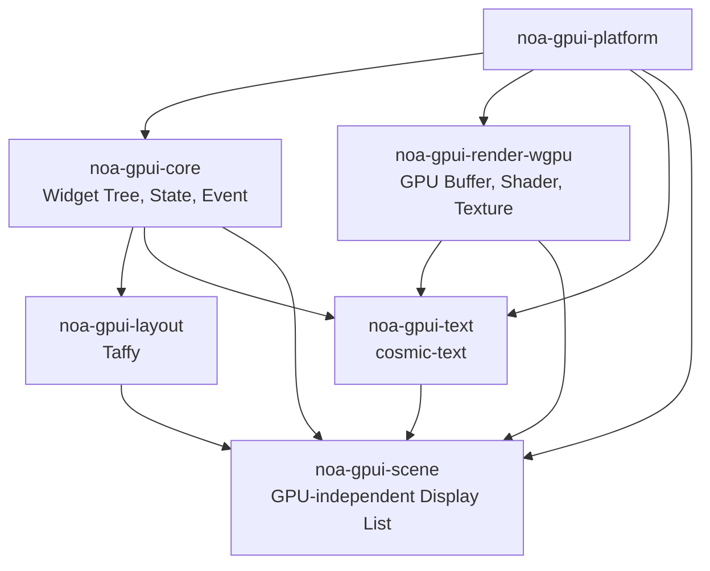
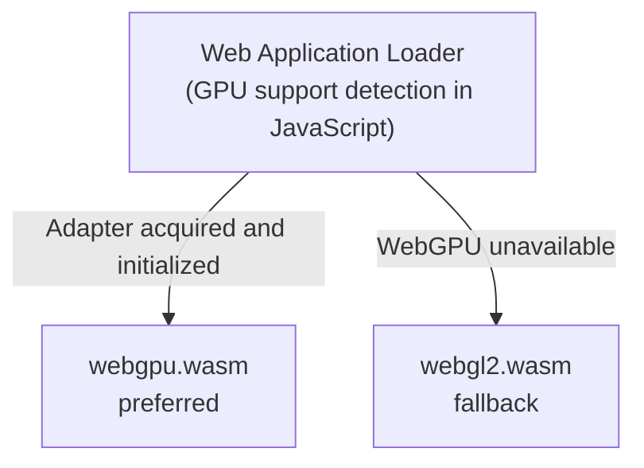

# Recommended Architecture for a Cross-Platform UI Framework in Rust

- Status: implemented (Phases 1, 2, and 4). The main text is the original design; decisions and changes made during implementation are in the appendices at the end
- Last updated: 2026-11-14
- Target platforms: Windows / macOS / Linux / Web (iOS and Android were dropped from scope on 2026-11-12)

## Overview

Use `wgpu` for GPU abstraction and build a custom 2D UI renderer on top of it.

The design assumes this will not stay a single GUI app but will grow into an independent UI framework.

### Three Design Principles

1. Separate GPU abstraction from UI drawing commands.
2. Treat WebGL2 as the lowest common denominator, so WebGPU-specific extensions can be added later.
3. Keep layout, text processing, and draw caching independently optimizable.

### Basic Approach

Only GPU drawing is built in-house; text shaping and layout algorithms come from mature libraries. Implementing Japanese, emoji, Arabic, bidirectional text, font fallback, and Flexbox ourselves would cost far more development effort than GPU optimization.

When supporting the three desktop OSes and the Web, handling each OS's differences in text input, accessibility, and lifecycle tends to be a bigger problem than the cost of GPU API calls. For that reason, we do not start with an implementation that uses Blade or Vulkan/Metal directly.

The goal is not fully platform-independent code. Most of the UI, layout, and rendering is shared, and OS-specific features are confined to small Bridges.

---

## 1. Technology Stack

| Layer | Technology | Approach |
| --- | --- | --- |
| GPU abstraction | wgpu 30.x | Shared across all platforms |
| Windowing and input | winit | OS events and lifecycle |
| 2D drawing | Custom wgpu renderer | Optimized drawing of rectangles, rounded corners, and images |
| Text | cosmic-text + glyphon | Text shaping and Glyph Atlas |
| Layout | taffy | Flexbox / Grid |
| UI tree | Custom implementation | Incremental updates and memory optimization |
| Accessibility | AccessKit + Web-specific implementation | Connects to OS assistive features |
| Complex path drawing | Custom (`noa-gpui-scene::vector` + icon atlas) | Icons from SVG paths. vello_gpu was not adopted (appendix "Added after #16") |

Versions checked as of November 2026: wgpu 30.0.1, Taffy 0.15.1, glyphon 0.12.0 (docs.rs).

## 2. GPU Backends per Platform

| Platform | Preferred backend | Notes |
| --- | --- | --- |
| Windows | Direct3D 12 | Vulkan is also available |
| macOS | Metal | For Apple GPUs |
| Linux | Vulkan | OpenGL if needed |
| Web | WebGPU | Falls back to WebGL2 |

This priority order follows wgpu's official support table. The backend actually used is chosen based on what the device, driver, and browser support.

### WebGL2 as the Lowest Common Denominator

The strictest design constraint is on the Web. wgpu supports both WebGPU and WebGL2, but WebGL2 lacks some features of modern GPU APIs. Basic drawing is therefore implemented under these conditions:

- Do not require Compute Shaders.
- Build around Vertex Shaders and Fragment Shaders.
- Use Instanced Rendering extensively.
- Do not require Storage Buffers; base everything on Vertex Buffers and Uniform Buffers.
- Do not depend on complex GPU synchronization or advanced texture features.

Under these conditions, basic UI drawing can be shared across all platforms, while leaving room to add WebGPU-specific optimizations later.

> **Note:** Automatic fallback for browsers without WebGPU does not happen just by adding wgpu as a dependency. The build configuration of backend features, detection of available APIs, and switching when initialization fails must be designed explicitly ([7. Cargo Features and Web Build Strategy](#7-cargo-features-and-web-build-strategy)).

## 3. Platform Constraints to Design Before the GPU

### 3.1 Japanese Input Needs a Dedicated Platform Bridge

`WindowEvent::Ime` in `winit 0.30.13` has support limitations, and the Web is listed as unsupported.

For that reason, text input alone is implemented per platform.

| Environment | Input handling |
| --- | --- |
| Windows / macOS / Linux | winit IME events |
| Web | A hidden DOM `textarea` and composition / input events |

The interface seen by UI Core is shared; only the input-side implementation is swapped.

```rust
// Initial draft
pub enum TextInputEvent {
    CompositionStart,
    CompositionUpdate(String),
    CompositionEnd,
    Insert(String),
    DeleteBackward,
    SelectionChanged {
        start: usize,
        end: usize,
    },
}
```

In practice, UTF-8 byte offsets, UTF-16 offsets, and grapheme cluster boundaries must be converted between each other correctly. This matters especially for emoji and Japanese.

### 3.2 Accessibility Is Not Complete in the Shared Layer Either

AccessKit has adapters for Windows, macOS, and Linux. An adapter for Canvas-based Web, however, is still listed as planned in the official repository.

For the Web, exposing the accessibility tree through HTML elements, focus synchronization, and screen reader support are designed separately.

## 4. Rust Workspace Layout

Responsibilities are separated from the start. To avoid splitting into too many crates, the layout centers on the following six (the actual layout as of 2026-11-14; for where each feature lives, see [feature-map.md](feature-map.md)).

```text
noa-gpui/
├── Cargo.toml
├── crates/
│   ├── ui-scene/src/         display_list / geometry / clipping / batch / vector
│   ├── ui-text/src/          lib.rs (holds text shaping and layout)
│   ├── ui-layout/src/        lib.rs (Taffy adapter)
│   ├── ui-core/
│   │   ├── src/              tree / widget / event / invalidation / theme / overlay /
│   │   │                     animation / shortcut / clipboard / text_edit / date / styling
│   │   ├── src/widgets/      widgets (one to a few per file)
│   │   ├── tests/            integration tests per feature group
│   │   └── benches/          ui_tree / table / desktop / styling
│   ├── ui-render-wgpu/
│   │   ├── src/              renderer / pipelines / buffers / gpu / images / icons /
│   │   │                     backdrop / offscreen / software / png
│   │   ├── src/shaders/      common / quad / image / icon / backdrop (.wgsl)
│   │   ├── tests/render.rs   draws on the GPU and reads pixels back
│   │   └── benches/gpu_frame.rs
│   └── ui-platform/
│       ├── src/              app / screen / input / windows / accessibility / clipboard /
│       │                     system_menu / linux_tray / reopen / wake / pty / headless
│       └── examples/         hello / snapshot
├── apps/
│   ├── demo/                 screens shared by desktop and Web (catalog / mini_os)
│   ├── desktop/
│   └── web/
├── scripts/verify.sh
└── tools/linux-desktop/
```

### Dependency Direction

Dependencies always go in the following single direction.



Arrows mean "depends on" (`A --> B` means A uses B). Keep this consistent with each crate's `Cargo.toml`.

- `noa-gpui-platform` drives this whole system from the outside.
- `noa-gpui-core` and below (`noa-gpui-scene` / `noa-gpui-text` / `noa-gpui-layout` / `noa-gpui-core`) do not bring in `wgpu::Device`, `winit::Window`, or the like.
- `crates/ui-core/tests/architecture.rs` checks this direction and the independence from the GPU and windowing against `Cargo.toml`.

## 5. Renderer Internals

### 5.1 The Display List as the Drawing Boundary

A sequence of draw commands (the Display List) sits between the UI tree and GPU processing.

```rust
// Design example. Rect, Color, etc. are defined separately.
pub enum DrawCommand {
    Quad {
        rect: Rect,
        radius: [f32; 4],
        color: Color,
    },
    Image {
        rect: Rect,
        image: ImageId,
    },
    Text {
        position: Point,
        layout: TextLayoutId,
    },
    PushClip {
        rect: Rect,
    },
    PopClip,
}
```

- Draw commands contain no GPU handles.
- The order of the command sequence is meaningful. Drawing optimizations must not break the order.

### 5.2 Rectangles Are Drawn with Instanced Rendering

| Element | Content |
| --- | --- |
| Shared Quad Geometry | One kind |
| Instance attributes | position / size / color / corner radius / border / UV |
| Effect | Many rectangles can be drawn efficiently with the same Geometry and shader |

- Rounded corners are computed in the Fragment Shader with a Signed Distance Field (SDF). There is no need to generate complex meshes on the CPU for each rounded corner.
- Size, color, corner radius, and border are instance attributes, and consecutive rectangles are drawn together.
- Ordering relative to images and text, Clips, and blend state are preserved. Rectangles on screen are not batched unconditionally; they are batched only as far as draw order can be kept.

### 5.3 Three Render Pipelines to Start

| Pipeline | Draws | Implementation approach |
| --- | --- | --- |
| Quad | Backgrounds, rounded corners, borders | SDF + Instancing |
| Image | Images, icons | Texture sampling |
| Text | Text, selections | glyphon's Glyph Atlas |

- There is no need to merge every draw type into one giant shader from the start.
- The Text Pipeline is left to glyphon. Consecutive commands are split and issued so that text and shapes are drawn in the correct order. glyphon is designed to fit into an existing wgpu render pass.

### 5.4 Clipping

- In the initial implementation, rectangular Clips are handled with wgpu's Scissor Rect. Nested rectangular Clips only require computing the intersection, so they are relatively cheap.
- Introduce Stencil or a Mask Texture once rounded-corner Clips are needed.
- Intermediate textures use a lot of memory, so avoid a design that puts every Widget on its own layer.

## 6. Minimizing Redraws

UI updates are split by the following three Dirty Flags.

| Dirty Flag | Required work | Example |
| --- | --- | --- |
| Layout | Layout recalculation + drawing update | Amount of text changes |
| Paint | Regenerate draw commands | Background color changes |
| Composite | Reuse existing drawing results where possible | Opacity change on an independent Layer |

- In the early stage, keep rebuilding of layout and the Display List to a minimum for the changed subtree. On the GPU side, drawing the full final frame every time is sufficient.
- Partial GPU redraws make transparency, rounded-corner Clips, scrolling, and overlap hard to handle. It is safer to add them after a bottleneck has been confirmed.
- The UI tree is managed with Generational IDs, and only subtrees with differences are updated.
- Storing Widgets together in an Arena can be expected to improve memory locality more than creating many `Box`es or `Arc`s per Widget.

## 7. Cargo Features and Web Build Strategy

### 7.1 wgpu Dependency Configuration

In wgpu 30.x, GPU backends can be selected with Cargo features. Leaving unused backends out of the build may reduce executable size and dependencies.

Example configuration for `ui-render-wgpu/Cargo.toml`:

```toml
[package]
name = "noa-gpui-render-wgpu"
version = "0.1.0"
edition = "2024"

[features]
default = []

native = [
    "wgpu/dx12",
    "wgpu/metal",
    "wgpu/vulkan",
    "wgpu/gles",
]

webgpu = ["wgpu/webgpu"]
webgl2 = ["wgpu/webgl"]

[dependencies]
wgpu = { version = "30.0.1", default-features = false, features = ["std", "wgsl"] }
glyphon = "0.12.0"
bytemuck = { version = "1", features = ["derive"] }
```

- The app enables one of `native`, `webgpu`, or `webgl2`.
- CI verifies each of the three builds.

### 7.2 Two Wasm Builds for the Web

The Web uses a two-build approach from the early stage. wgpu's official Web build examples also produce separate WebGPU and WebGL2 builds.



- Do not decide based only on whether `navigator.gpu` exists; confirm all the way through actually acquiring an Adapter and initializing successfully.
- If WebGPU is unavailable, load the WebGL2 build.
- Make it possible to recreate the Canvas itself when switching the GPU Context fails.

This setup keeps browser compatibility while keeping each build small.

## 8. wgpu Initialization and Lifecycle

### 8.1 Basic GPU Initialization Settings

The starting point for the common specification is `wgpu::Limits::downlevel_webgl2_defaults()`. Limits for WebGL2 are provided officially, and not requesting unnecessary GPU features leads to compatibility across a wide range of environments.

| Item | Initial setting |
| --- | --- |
| Required Features | Empty in principle |
| Required Limits | Based on the WebGL2 minimum |
| Shader | WGSL |
| Present Mode | FIFO (VSync) |
| Frame Latency | 2 to start |
| Surface Format | Prefer sRGB among supported Formats |
| MSAA | Initially 1; add more if needed |

In wgpu 30, `SurfaceConfiguration::desired_maximum_frame_latency` adjusts the balance between latency and throughput. If the UI is light, 1 is also a strong option, but measure with 2 first and then decide.

### 8.2 Lifecycle Management

GPU state is managed in line with winit's `ApplicationHandler`.

```rust
// Conceptual state model. Ownership of the GPU Device, Surface, and Window is managed in separate structs.
enum GraphicsState {
    Uninitialized,
    Initializing,
    Ready,
    Suspended,
    Recovering,
}
```

- **Handle Device loss and Surface loss separately.** When only the Surface is lost, do not recreate all GPU resources. When the Device itself is lost, rebuild Pipelines, Textures, and so on.

## 9. Memory Management Design

The key to reducing memory usage is managing image and glyph caches more than GPU buffers.

### 9.1 Three Kinds of Cache

| Cache | Stores | Eviction policy |
| --- | --- | --- |
| Glyph Atlas | Rasterized glyphs | LRU + capacity limit |
| Image Cache | Images uploaded to the GPU | Evict unused images first |
| Pipeline Cache | Render Pipelines | Resident by default |

### 9.2 Texture Atlas Capacity

Atlas capacity can be changed per device. The pixel area a `2048 × 2048` Texture theoretically occupies is as follows (not including Mipmaps or memory added inside the driver).

| Format | Per pixel | Size |
| --- | --- | --- |
| R8 | 1 byte | 4 MiB |
| RGBA8 | 4 bytes | 16 MiB |

- Separate the Glyph Atlas into one for monochrome and one for color emoji, and grow it only when needed.
- Instead of allocating a huge fixed Texture, grow gradually from a small Atlas to save initial memory.
- In WebGL2 environments, check the actual `adapter.limits()` so as not to request Textures larger than the device limits.

### 9.3 Initial Performance Targets

These are provisional development targets, not measurements of existing libraries.

| Metric | Initial target |
| --- | --- |
| GPU drawing when idle | 0 FPS (waiting for events) |
| Frame budget at 60Hz | Within 16.7ms |
| Frame budget at 120Hz | Within 8.3ms |
| Unchanged Widgets | Do not regenerate layout or draw commands |
| Glyph Atlas | Configurable size limit |
| GPU resources | Avoid creating new ones every frame |

- Measure frame time at p95 and p99, not just the average.
- Record GPU time, CPU draw preparation time, and text shaping time separately.

## 10. Implementation Roadmap

| Phase | Name | Content |
| --- | --- | --- |
| 1 | GPU Renderer MVP | Draw rectangles, rounded corners, images, and text with wgpu. Reach a state where the same Display List renders on Windows/macOS/Linux and WebGPU/WebGL2. |
| 2 | UI Core / Layout | Introduce the Widget Tree, Taffy, Dirty Tracking, Hit Testing, and Focus management. Add benchmarks that scroll and update with many Widgets. |
| 3 | Mobile support (cancelled) | Not done, since iOS/Android were dropped from scope (2026-11-12). |
| 4 | Optimization | Optimize the CPU-side Display List cache, GPU buffer reuse, Glyph Atlas capacity control, and scrolling. Introduce partial redraws and complex GPU processing after looking at measurements. |

We do not implement every UI component from the start. First get the following basic widgets working, prioritizing correct display and input on each OS.

- Button
- Text
- Image
- Container
- ScrollView
- TextField

After the basic widgets worked, the standard macOS UI components were implemented in [#15](https://github.com/simota/noa-gpui/issues/15) (child issues #6–#14). Decisions and known constraints per category are collected in the appendices at the end.

### First Milestone

Complete a small wgpu renderer that can draw 1,000 or more custom Widgets and runs on both Desktop and WebGL2. Using this as the performance baseline lets design decisions for the whole framework be made from measurements.

---

## Appendix: Decisions Made While Implementing Phase 1

While implementing Phase 1 ([#1](https://github.com/simota/noa-gpui/issues/1)), the following points in the main text's design examples were made concrete or changed.

- **`DrawCommand` extensions:** `Quad` gained `border` (width and color), and `Text` gained `rect` (the layout's bounding box) and `color`. `rect` is used for culling and overlap checks.
- **Order-preserving batching (`noa-gpui-scene::batch`):** Besides consecutive commands, a command joins the previous batch of the same kind only if it does not overlap any batch in between. The result looks identical to drawing "strictly in order." Overlap checks use a uniform grid of 32 logical px, so the time is nearly linear in the number of Widgets.
- **Text uses one glyphon `TextRenderer` per batch:** One Atlas is shared while the ordering between text and shapes is preserved.
- **No `first_instance`:** WebGL2 lacks it, so instance buffers are specified as byte-offset slices.
- **Color handling:** Input colors are sRGB. If the surface is an sRGB format (desktop, WebGL2), the shader converts to linear; otherwise (WebGPU's `Bgra8Unorm`) it outputs as is. glyphon picks `ColorMode::Accurate` / `Web` by the same rule.
- **Images:** In Phase 1, one texture per image. Atlasing is handled in Phase 4 ([#4](https://github.com/simota/noa-gpui/issues/4)).
- **Fonts:** The Web has no system fonts, so Inter (OFL) is bundled. Japanese displays on desktop through fallback to system fonts, but is not supported on the Web.

### Phase 1 Measurements

One Widget = rounded Quad + image + text. Measured on an Apple M1 Pro. CPU time is the time from building the Display List to submission, excluding the VSync wait (surface acquisition).

| Environment | Widgets | Batches | fps | CPU time p95 |
| --- | --- | --- | --- | --- |
| Desktop / Metal (2560×1600, 120Hz) | 1,500 | 6 | 118 | 3.74 ms |
| Desktop / Metal (2560×1600, 120Hz) | 5,000 | 6 | 120 | 3.53 ms |
| Desktop / Metal (2560×1600, 120Hz) | 10,000 | 10 | 119 | 5.89 ms |
| Chrome / WebGPU (1280×657, headless 60Hz) | 1,500 | 6 | 60 | 3.40 ms |
| Chrome / WebGL2 (1280×657, headless 60Hz) | 1,500 | 6 | 60 | 4.40 ms |

## Appendix: Decisions Made While Implementing Phase 2

Decisions made in Phase 2 ([#2](https://github.com/simota/noa-gpui/issues/2)).

- **Widget Tree (`noa-gpui-core::tree`):** Widgets are placed in an Arena as `Box<dyn Widget>` and referenced by Generational ID (index + generation). A removed ID never becomes valid again.
- **Three stages of incremental update:**
  - Layout: Pass the changed nodes' styles to Taffy and `mark_dirty` them. Taffy reuses its cache for clean subtrees. Reading results back is limited to subtrees that may have changed (touched nodes or nodes whose size changed).
  - Paint: Each Widget keeps its draw commands in its own coordinate system. They are regenerated only when the Widget requests it or its size changes.
  - Composite: Cached commands are translated and concatenated into a single Display List. Subtrees outside the Clip are excluded at this stage. Scrolling needs only Composite; contents are neither re-laid out nor repainted.
- **If nothing changed, `prepare` returns `None` and nothing is drawn** (0 FPS when idle). However, a frame is always drawn after reconfiguring the surface and after a drawing failure.
- **Taffy's rounding is disabled:** Taffy's rounding walks the whole tree on every computation, making a single node change O(whole tree). Layout stays fractional, and Quad edges are handled by SDF anti-aliasing.
- **Events:** Pointer events go to the hit Widget (or the capturing Widget while the pointer is captured), keys and text go to the focused Widget, and both propagate to ancestors. An unhandled Tab moves focus. Widgets notify the app with messages (`ButtonClicked`, `TextChanged`).
- **TextField (as of Phase 2) accepted only committed text and Backspace.** Desktop IME and caret movement were added in [#5](https://github.com/simota/noa-gpui/issues/5) (appendix below).

### Phase 2 Measurements

One row = a row container with background + image + two labels + spacer. Measured on an Apple M1 Pro.

| Environment | Rows (Widgets) | Operation | CPU time p95 | p99 |
| --- | --- | --- | --- | --- |
| Headless (`UiTree::prepare` only) | 10,000 (40,002) | Scroll | 0.10 ms | 0.11 ms |
| Headless (`UiTree::prepare` only) | 10,000 (40,002) | Scroll + update 1 row | 4.38 ms | 4.78 ms |
| Desktop / Metal (60Hz) | 10,000 (50,017) | Scroll + update 1 row | 7.77 ms | 9.05 ms |
| Chrome / WebGPU (60Hz) | 10,000 (50,017) | Scroll + update 1 row | 7.80 ms | 8.30 ms |
| Chrome / WebGL2 (60Hz) | 10,000 (50,017) | Scroll + update 1 row | 7.70 ms | 8.30 ms |

60fps held in every environment. CPU time on Desktop and Web also includes preparing and submitting draws to the GPU.

### Known Constraints (Resolved in Phase 4)

Updating one row cost time proportional to the number of children of the scroll container holding that row (about 3–4ms at 10,000 rows). Phase 4 resolved this with layout boundaries and binary search for culling (appendix below).

## Appendix: Desktop IME Support

[#5](https://github.com/simota/noa-gpui/issues/5) added IME (Japanese input) to the desktop TextField. The `TextInputEvent` draft in §3.1 was realized with the following two events.

| Draft in §3.1 | Implementation |
| --- | --- |
| `CompositionStart` / `CompositionUpdate` / `CompositionEnd` | `Event::Composition { text, cursor }` (an empty `text` ends composition) |
| `Insert` | `Event::Text` (both IME commits and ordinary key input) |
| `DeleteBackward` / `SelectionChanged` | `Event::KeyDown` (Backspace / Delete / ← / → / Home / End) |

- **Positions:** The caret is held as a UTF-8 byte offset and always sits on a grapheme cluster boundary (`unicode-segmentation`). The composition cursor position winit passes is also a byte offset and can be used as is. Conversion to UTF-16 is needed only when talking directly to the Web (DOM) or OS APIs (Web IME).
- **Caret during composition:** While typing, the macOS IME sends the end of the composition string `(n, n)`; while converting, it sends the range of the selected clause, such as `(0, 9)` (confirmed in the demo's log). In both cases the caret goes at the end of the range, and the selected clause is shown with a thick underline.
- **Enabling IME:** `set_ime_allowed(true)` is on only while the focused Widget returns `Widget::text_input_area`, and `set_ime_cursor_area` places the candidate window next to the caret. IME is disabled when focus is on a button or similar.
- **Preventing double input:** On macOS, winit sends `Ime::Commit` only when there is a composition string, and does not send that key's `KeyboardInput`. Ordinary key input arrives as before via `KeyboardInput`'s `text`.
- **Font fallback:** `FontOptions::default()` uses the OS locale (e.g. `ja-JP`). For kanji shared across CJK, Japanese glyph forms are chosen.
- **Bugs fixed:** Layout updates that did not change size did not set the whole tree's repaint flag, so repaints were skipped (`UiTree::invalidate`). Even after entering a composition string, the drawing for the empty state remained.
- **Not supported:** Web IME (winit 0.30 does not support it, so a separate mechanism using a DOM textarea is needed), selection ranges, and horizontal scrolling of long text.

## Appendix: Decisions Made While Implementing Phase 4

Decisions made in Phase 4 ([#4](https://github.com/simota/noa-gpui/issues/4)).

- **Layout boundaries (`LayoutTree::is_boundary` / `compute_subtree`):** A node whose size does not depend on its contents is a boundary. If all changes are inside a boundary, a partial computation is done with that boundary as the root. The check walks up parents per axis.
  - A fixed size does not depend on contents.
  - A percentage qualifies only if the parent's size on that axis does not depend on its contents.
  - Cross-axis stretch likewise qualifies only if the parent does not depend on its contents.
  - A flexing main axis qualifies only if basis and minimum size are fixed and the siblings also do not depend on their contents.
  - When it cannot be determined, the node is treated as content-dependent (the safe side).
  - Insertion, removal, and window resizes compute the whole tree.
  - Tests confirm that partial computation results match full computation.
- **Binary search for culling and hit testing:** When children's draw bounds are ordered top to bottom (both top and bottom edges monotonically increasing), the visible children are found by binary search. If the order is broken (column-reverse, etc.) or a boundary's draw bounds changed, it falls back to a linear scan.
- **Draw-side cache:** `DisplayList` and `TextLayouts` carry revision numbers. If both and the screen size match the previous frame, the Renderer skips batching, uploading, and text preparation, and reuses the previous frame's GPU data. Per-Widget draw commands have been cached by UiTree since Phase 2.
- **GPU buffers:** Instance buffers double only when they run out; otherwise they are overwritten and reused. `FrameStats::buffer_allocations` tests that steady-state allocations are zero.
- **Glyph Atlas:** glyphon handles LRU eviction, separation into monochrome (R8) and color (RGBA8), and gradual growth from 256px. The limit is set as the device texture limit with `GpuOptions::max_texture_size`.
  - If a frame needs glyphs beyond the limit, that frame results in `RenderError::TextPrepare`. Memory use never exceeds the limit.
  - On a memory warning (§8), `Renderer::trim_caches` shrinks the Atlas back to its minimum size.
- **No partial redraw:** Measurements (table below) showed full redraws fit comfortably within the 120Hz budget (8.3ms). It is not worth the complexity from combining with transparency, Clips, and scrolling. Nothing is drawn when idle, so no wasted full redraws happen either. Revisit if measurements show the budget being exceeded on low-end GPUs (such as integrated GPUs on WebGL2).

### Phase 4 Measurements

Measured on an Apple M1 Pro.

| Measurement | Scale | Phase 2 p95 | Phase 4 p95 |
| --- | --- | --- | --- |
| `UiTree::prepare` (scroll only) | 10,000 rows | 0.10 ms | 0.002 ms |
| `UiTree::prepare` (scroll + update 1 row) | 10,000 rows | 4.38 ms | 0.013 ms |
| `UiTree::prepare` (scroll + update 1 row) | 50,000 rows | — | 0.012 ms |
| Whole-demo CPU time (Desktop / Metal) | 10,000 rows | 7.77 ms | 1.93 ms |
| Whole-demo CPU time (Desktop / Metal) | 50,000 rows | — | 1.86 ms |
| Whole-demo CPU time (Chrome / WebGPU) | 50,000 rows | — | 0.50 ms |
| Whole-demo CPU time (Chrome / WebGL2) | 50,000 rows | — | 2.10 ms |

Cost of a full redraw (`cargo bench -p noa-gpui-render-wgpu --features native --bench gpu_frame`, 2560×1600, with contents changing every frame):

| Widgets | CPU prep p95 | GPU p95 | GPU p99 |
| --- | --- | --- | --- |
| 1,500 | 0.75 ms | 1.84 ms | 1.96 ms |
| 5,000 | 2.09 ms | 2.50 ms | 3.06 ms |

Thanks to caching, preparing a frame whose contents do not change takes under 0.001ms.

## Appendix: Decisions for the Component Foundation (#6)

Mechanisms added as groundwork for implementing the standard macOS components ([#6](https://github.com/simota/noa-gpui/issues/6)). All of them live in `noa-gpui-core`, and their behavior can be checked under FOUNDATION in the UI catalog (`--scene=catalog`).

- **Theme (`theme.rs`):**
  - Widgets specify colors either as a fixed color or as a role (`Role::Text`, `Role::Accent`, etc.). Roles are resolved against the current `Theme` at paint time.
  - `UiTree::set_theme` only rebuilds every Widget's draw commands; it does not recompute layout.
  - Hover, pressed, focus ring, and selection colors are derived from the accent color.
  - The OS light / dark setting is passed in by the demo from winit's `ThemeChanged`.
  - Control size (mini to large) is a per-Widget setting and is handled in each component's issue.
  - `Theme::new` selects the design (`Design`: Flat + Vibrancy / Big Sur / Liquid Glass / Aero / Metro / Fluent 2 / Noa) and light or dark. `Design::Noa` uses the color scheme of the mascot of Noa (the terminal): dark is the hoodie's charcoal, light is Ember's white, and the accent is a single color, the prompt's orange `#E8A33D`. Surfaces are translucent colors layered over the base; windows, menus, and popovers blur what is behind them and lay the base on top at 72% opacity. `Theme::with_design` carries over a re-chosen accent and status colors, and replaces colors that were the old design's defaults with the new design's defaults. `Theme::with_increased_contrast` draws control borders at 3:1 contrast against the background.
- **Disabled state:**
  - `UiTree::set_enabled` disables a whole subtree.
  - A disabled subtree is skipped in hit testing (the pointer reaches the enabled ancestor) and removed from the focus order.
  - Focus, hover, and pointer capture are released at the moment of disabling.
  - For painting, `PaintCx::color` fades colors by `Theme::disabled_opacity`. Widgets need no special handling.
- **Pointer shape (`Widget::cursor` and `UiTree::cursor`, `Cursor` in `event.rs`):**
  - A Widget returns the pointer shape at a position via `cursor(local, size)` (I-beam, hand, column or row boundary, edge or corner resize, grabbing hand, etc.). `None` defers to the parent. The tree walks from the innermost Widget under the pointer toward ancestors and uses the first shape answered.
  - If a Widget has captured the pointer, only that Widget is asked (the resize shape stays even when a divider drag leaves the divider). During a drag and drop started by a Widget, the shape is a closed hand. Over a disabled Widget and outside the window, it is the arrow.
  - `noa-gpui-platform` reads `UiTree::cursor` on every input event and every frame, and passes it to winit's `Window::set_cursor` only when it changes (on the Web this becomes the CSS cursor).
  - Supported widgets: text inputs (TextField, SecureTextField, SearchField, ComboBox, NumberInput, TokenField, TextArea, TextView, the input fields of CommandPalette and FindBar, InlineEditableLabel while editing, selectable Label, Terminal) use the I-beam. Over icons and buttons it stays the arrow. SplitView dividers and TableView header boundaries use column (row) resize, and the edges and corners of ResizableBox and InnerWindow use the resize matching their direction.
- **Overlays (`overlay.rs`):**
  - `UiTree::open_overlay` creates a root separate from the main tree.
  - Size is determined by contents (`LayoutTree::compute_fit_content` computes max-content).
  - Position is determined by `Placement`: below the anchor (above if it does not fit), beside it (the opposite side if it does not fit), or centered. In every case it is kept within the window.
  - Overlays are drawn after the main tree and hit-tested before it.
  - `OverlayOptions` specifies three things:
    - Whether a click outside or Esc closes it (light dismiss)
    - Whether that dismissing click passes through to what is below (menus do not pass it; popovers do)
    - Whether it is modal (blocks input to what is below and cycles Tab within the overlay)
- **Animation (`animation.rs`):**
  - A Widget receives `Event::AnimationFrame` in the next frame only when it calls `request_animation_frame`. To continue, it calls again each time.
  - When there are no more requests, the app stops drawing, so the 0 FPS idle policy is unchanged.
  - The app passes the time with `UiTree::set_now`. Tests can pass any time.
  - Interpolation uses `Transition` (with easing).
  - Hover changes are now reported to Widgets with `Event::HoverChanged`. Button's hover color fades over 120ms.
  - Enabling `UiTree::set_reduce_motion` makes move, resize, and fade transitions jump to their end state. Progress indicators (spinners, indeterminate progress) and scrolling keep moving.
- **Keyboard (`shortcut.rs`):**
  - Character keys arrive as `Key::Char` (lowercase, the character without modifiers applied).
  - `Modifiers::command` means Cmd on Apple and Ctrl elsewhere. The platform layer sets it (the Web decides from `navigator.platform`).
  - In a subtree where `Widget::focus_group` is true, arrow keys move focus (wrapping around at the ends). Tab treats it as a single stop and returns to the last focused item.
  - Shortcuts registered with `UiTree::add_shortcut` emit `ShortcutPressed` only when the focused Widget did not handle the key.
- **Text editing (`text_edit.rs`, `clipboard.rs`, `widgets/editable.rs`):**
  - `TextEditor` is an editing model without layout, responsible for:
    - Selection
    - Word and line movement (Option / Cmd on Apple, Ctrl / Home / End elsewhere)
    - Deletion by grapheme
    - Undo / redo
    - Clipboard
  - Undo granularity: consecutive typing is merged into one, separated by whitespace, cursor movement, and paste. Consecutive deletions are also merged into one.
  - Operations that need layout, such as moving up and down or to the end of a wrapped line, are done on the Widget side.
  - TextField and the new TextArea (multi-line, wrapping, grows with content) share the editing part `Editable`.
  - Selection gestures: drag, double-click (word), triple-click (line), Shift+click.
  - TextField scrolls overflowing text horizontally to keep the caret visible and clips its interior.
  - noa-gpui-text gained multi-line caret positions, hit testing, and selection rectangles.
  - The clipboard is swapped via the `Clipboard` trait. Desktop uses the OS clipboard (arboard); the Web uses in-app memory.
  - Bug fixed: `MeasureInput::wrap_width` wrapped at a width that included padding. It now uses the content box width.
- **Drag and drop:**
  - A Widget starts it with `start_drag`. `DragOver` propagates from the Widget under the pointer to its ancestors, and the Widget that calls `accept_drop` becomes the drop target.
  - When the drop target changes, `DragLeave` is sent to the previous target.
  - On release, `Drop` is sent to the drop target and `DragEnd` to the drag source. Esc cancels.
  - Files from the OS (winit's `HoveredFile` / `DroppedFile`) arrive as the same events.
  - `UiTree::move_child` was added for reordering.
- **Multiple windows:**
  - Each window has its own surface (the `WindowSurface` returned by `GpuContext::create_window_surface`), Renderer, and UiTree.
  - The GPU device and TextStore are shared.
  - In the demo, a screen (`Screen`) requests a window and the app opens it.
- **Accessibility:**
  - `UiTree::accessibility_update` builds the AccessKit tree. Widgets expose role, label, and value through `accessibility_role` and `accessibility`.
  - Widgets without a role are omitted from the tree and their children are reattached.
  - The tree sets position, disabled state, focus, and the Focus action.
  - `UiTree::accessibility_action` executes Click / Focus from assistive technology.
  - The demo connects accesskit_winit per window and sends the tree on frames where something changed.

### What Was Verified

- Unit and integration tests verify each of the mechanisms above. For the main tests, temporarily breaking the implementation was confirmed to make the test fail (mutation check).
- Actually ran and checked on the Web (WebGPU) and Linux (webtop's Ubuntu + XFCE, lavapipe).
  - Web: operated each catalog section in a browser (theme switching, disabled state, menus, popovers, modals, row reordering, text editing).
  - Linux: fetched the tree over AT-SPI and confirmed that a Button's Click updates the label.
  - Linux: opened a second window, typed into it, and closed it.
  - Linux: confirmed copying and pasting in both directions with the OS clipboard.
- In the 10,000-row benchmark, scrolling is p95 0.002ms and updating one row is p95 0.012ms, unchanged from Phase 4.

### Known Constraints

- **Reading text aloud:** The contents of text inputs are passed as the AccessKit value. However, they do not appear in AT-SPI's Text interface (because AccessKit's `TextRun` node is not implemented). For a screen reader to read the text being typed, `TextRun` is required.
- **File drops from the OS:** On some platforms winit does not report the pointer position during a drag. In that case the drop position is the last known pointer position. On the Web, winit does not support file drops.
- **Web constraints:** The OS clipboard, multiple windows, and accessibility (a Web-specific implementation using ARIA) are not supported.
- **Not verified:**
  - Accessibility (VoiceOver / Narrator) and multiple windows on real macOS and Windows machines.
  - File drops from the OS (not checked on any platform).

## Appendix: Decisions for Buttons (#7)

Widgets added in [#7](https://github.com/simota/noa-gpui/issues/7) and the mechanisms introduced for them. They are listed under CONTROLS in the UI catalog.

- **Shape drawing (`DrawCommand::Shape`):**
  - Line segments with round caps and triangles were added to draw checkmarks, chevrons, and triangles.
  - They are drawn in the same instance buffer of the Quad pipeline, and the fragment shader evaluates a distance field (SDF). They use spare space in the instance, so no new pipeline or texture is needed.
  - `PaintCx` provides `line`, `triangle`, `chevron`, and `checkmark`.
  - Tests that draw on the GPU and read pixels back verify the shapes.
- **`Event::Activate`:** An event meaning "perform this widget's primary action." Used both for key assignments (next item) and for Click from assistive technology. Each widget can respond without faking pointer input.
- **Key assignments (`Widget::key_equivalent`):**
  - Used for a default button pressed by Return, a cancel button pressed by Esc, and buttons pressed by shortcuts such as Cmd+D.
  - Only when the focused Widget did not use the key is `Activate` sent to the first matching enabled Widget.
  - The search scope is inside the modal overlay if one is open, otherwise the main tree.
  - Closing an open menu or popover with Esc takes priority over the cancel button.
  - Following macOS, the focused button is pressed with Space. Return reaches the default button. Previously Return also pressed the focused button, but that behavior was dropped.
- **Menus (`Menu`, `EventCx::open_menu`):**
  - When a widget calls `open_menu`, the tree opens the menu as an overlay and moves keyboard focus into the menu.
  - Whether closed by choosing an item, Esc, or a click outside, `Event::MenuClosed { chosen }` is sent to the widget that opened it, and focus returns to that widget.
  - Menu interaction:
    - Pointer: hover highlights, and releasing over an item chooses it (press, drag, and release also works).
    - Keyboard: up and down keys move while skipping disabled items and separators, and Return / Space chooses.
  - The context menus and submenus in #13 are also built on this mechanism.
- **Widgets:**
  - Button extensions: seven styles (push / gradient / recessed / inline / rounded rect / textured / circular), help (`?`), icons (combined with a label, or icon only), default / cancel / shortcut.
  - New: Checkbox (on / off / mixed), RadioGroup (arrow keys move the selection), Switch (the knob moves over 150ms), Disclosure (triangle and button), PopUpButton, PullDownButton, ComboButton, SegmentedControl (single selection / multiple selection / momentary).
- **Messages:** One shared type per kind.
  - `SelectionChanged` (radio, pop-up, single-selection segments)
  - `Toggled` (switch, disclosure)
  - `MenuChosen` (pull-down, combo button)
  - `CheckboxChanged`
  - `SegmentsChanged` / `SegmentClicked`
- **Accessibility:** Each widget exposes the following roles, together with check and switch on / off, disclosure state, and pop-up values.
  - CheckBox
  - RadioGroup
  - Switch
  - DisclosureTriangle
  - ComboBox (pop-up)
  - Button + HasPopup (pull-down, combo button)
  - TabList (segments)
- **Control size (`ControlSize`):**
  - Each widget's `control_size` selects mini / small / regular / large.
  - With regular as the baseline, dimensions are multiplied by 0.75 / 0.86 / 1.0 / 1.15, and font size is rounded at the same ratio.
  - Applies to: Button, Checkbox, RadioGroup, Switch, pop-up, pull-down, and combo buttons, SegmentedControl.
- **Accessibility of individual options (`Widget::accessibility_items`):**
  - RadioGroup options (RadioButton) and SegmentedControl segments (Tab) are each exposed as child nodes.
  - Child node ids are built from the Widget's slot number and item number (the top bit distinguishes them from Widgets).
  - A Click on a child node reaches the widget as `Event::ActivateItem(i)`.
- **Not verified:** On a real macOS machine, drawing was checked with screen captures, but operation via input was not, because the permission needed to send events from outside was not available.

## Appendix: Decisions for Value Input (#8)

Widgets added in [#8](https://github.com/simota/noa-gpui/issues/8) and the mechanisms introduced for them. They are listed under VALUES in the UI catalog.

- **Popovers (`EventCx::open_popover`):**
  - A widget can open a popover with any Widget as its content. As with menus, focus moves into the content, and a press outside (not passed through) or Esc closes it. On close, `Event::PopoverClosed` is sent to the widget that opened it and focus returns.
  - The content returns values to the opening widget with `notify_owner` (`Event::FromPopover`) and closes itself with `close_popover`. Used by the color well's picker and the date picker's calendar.
  - Because a press outside is not passed through, pressing the opening widget again only closes the popover (for widgets that open on press).
- **Linear gradients (`Shape::Gradient`):**
  - For the color picker's saturation/brightness plane and hue bar, a shape was added that fills a rounded rectangle with a horizontal or vertical gradient.
  - Like line segments and triangles, it is drawn in the Quad pipeline. Interpolation is done on sRGB values (the same as the CSS default), and conversion to the output color space happens after interpolation.
- **Increment and decrement from assistive technology (`Event::Increment` / `Decrement`):** AccessKit's Increment / Decrement are delivered to widgets. Sliders, steppers, and date pickers support them.
- **Dates (`noa_gpui_core::date::DateTime`):** Year, month, day, hour, and minute. Without an external crate, the weekday and adding days and months are computed by converting to a day count (Howard Hinnant's algorithm). Time zones and seconds are not handled.
- **Widgets:**
  - Slider: horizontal, vertical, circular; tick marks; snapping to ticks. Jumps to the pressed position and follows drags.
  - Stepper: increment, wrapping at the ends, repeat while held (every 0.08 seconds after 0.4 seconds, timed by animation frames). Combining it with a number field is synchronized by the app (example in the catalog).
  - ColorWell and ColorPicker: an HSV picker (saturation/brightness plane, hue bar, 8 color swatches, hex display). The picker can also be used on its own.
  - DatePicker: text style (month / day / year and hour:minute fields, digit entry, up and down keys), text + stepper style, graphical style (calendar and clock), a calendar popover from the text style, and value ranges.
  - PathControl: a standard style that lays out the elements, and a pop-up style that chooses from a menu.
- **Messages:** `ValueChanged` (slider, stepper), `ColorChanged`, `DateChanged`, `PathItemClicked`.
- **Accessibility roles:** Slider, SpinButton, ColorWell, DateInput / TimeInput / DateTimeInput, List (each path element is a Link child node) or ComboBox (pop-up style). Numeric widgets also expose value, minimum, maximum, and step.
- **Known constraints:**
  - The date format (`DateFormat`) changes only the order of the text field's fields, the separators, and 12 / 24-hour time. Calendar month and weekday names and AM / PM labels stay in English. The default stays month/day/year and 24-hour time as before; to follow the locale, the app passes `DateFormat::for_locale(text.locale())` (because changing the default would make existing apps' display change with OS settings).
  - When there is not enough width, the path control collapses middle elements into "…" (added in #21; "…" opens a menu of the collapsed elements).
  - The color picker handles only opaque colors (no alpha adjustment).

## Appendix: Decisions for Text Display and Input (#9)

Widgets added or extended in [#9](https://github.com/simota/noa-gpui/issues/9) and the mechanisms introduced for them. They are listed under TEXT in the UI catalog (the Label and TextField sections were moved from WIDGETS).

- **Text alignment (`noa_gpui_text::TextAlign`, `TextStyle::align`, `Label::align`):** Aligns lines to the start (default), center, or end. Applies both to wrapped lines and to lines split by `\n`. cosmic-text aligns each paragraph within that paragraph's width (or the wrap width), so the text is shaped once to measure the longest line's width and then recomputed at that width. The block's size is the same as without alignment. When a Label is wider than its text (stretched by its parent), the text block is also placed by that alignment. Alert messages and informative text are centered line by line.
- **When only the wrap width changes (`TextStore::rewrap`):** Layout measures a wrapping Label at the narrowest width, the widest width, and the actual width, in that order. Changing the window width rewraps every paragraph. If the text and style are the same, the shaping result (glyphs) is kept and only the assignment to lines is redone (used by `CachedText::shape`). The resulting arrangement is the same as `TextStore::create` of the same text at that width. For a Layout with a different style it returns `false`, and the caller recreates it. The catalog's (2,344 Widgets) first frame went from 219 → 90ms, and the slowest frame while changing the width from 100 → 17ms (median of 9 runs in an x86-64 Linux sandbox; the measurement code is not in the repository).
- **Editing-part modes (`Editable`):**
  - Read-only: accepts only selection, movement, Cmd+A, and Cmd+C; does not accept typing, deletion, paste, undo, or IME composition. No caret is drawn.
  - Masked: displays "•" per grapheme cluster. Caret, selection, and click positions are handled by converting between display positions and content positions. Cmd+C / Cmd+X are received and do nothing (and are not passed to other widgets). Double-click selects everything instead of a word.
- **Shared single-line input part (`SingleLine`):** Shared by TextField, the secure field, the search field, and the combo box. Handles left and right padding (where icons and buttons go), caret tracking with horizontal scrolling, and `TextSubmitted` on Return. Emitting `TextSubmitted` does not mark Return as handled, so it also reaches the default button (the search field and token field handle it themselves).
- **IME:** Widgets that accept input return `text_input_area`, so they can compose with the mechanism from #5. Read-only widgets and the secure field do not return it, so IME is off (the same as macOS secure input).
- **Widgets:**
  - Label: truncation with an ellipsis (end, middle, start), maximum line count, selection and copy. Truncation determines the number of graphemes to keep by binary search. A truncating label shrinks to fit its parent (minimum width 0). Selectable labels are not truncated.
  - TextField: read-only, `TextSubmitted`. Selection, clipboard, undo, and horizontal scrolling were already supported. Disabled state is handled by `set_enabled`.
  - SecureTextField: masking, copy and cut prohibited, IME off. Passed to assistive technology still masked (role is PasswordInput).
  - SearchField: magnifying glass (pressing it opens a menu of recent searches, up to 10 entries, with a clear item), clear button, Esc to clear, `SearchSubmitted` on Return.
  - TokenField: Return or a comma makes a token. Pressing Backspace / ← at the start of input selects the last token, and Backspace / Delete again removes it. Lines wrap to fit the width. Emits `TokensChanged`.
  - ComboBox: at the end of input, fills in the rest of a prefix-matching candidate and selects it (continuing to type replaces it). The arrow button or ↓ opens the candidate menu.
  - TextView: multi-line editing with a fixed height. Automatically scrolls to where the caret is visible (it tracks during layout, so wheel scrolling is preserved), and also scrolls with the wheel. Can be made read-only.
- **Rich text:** Not handled. TextView is plain text only.
- **Known constraints:**
  - There is no handling that turns the remaining input of a token field into a token when focus is lost (`Event::FocusChanged(false)` only closes the completion list).
  - The widget never saves the search field's recent searches to a file. The app saves `SearchField::recents` and passes it to `with_recents` on the next launch.

## Appendix: Decisions for Progress and Status Display (#10)

Widgets added or extended in [#10](https://github.com/simota/noa-gpui/issues/10) and the mechanisms introduced for them. They are listed under STATUS in the UI catalog (the Image section was moved from WIDGETS and became Image view).

- **Animate only while visible:**
  - `UiTree::visible_rect` / `is_visible` were added. The Widget's rectangle is clipped by clipping ancestors (ScrollView, etc.) and the window bounds; if nothing remains, it is judged not visible. Widgets under an ancestor with `display: none` are also judged not visible because their size is 0.
  - `wants_animation_frame` counts only requests from visible Widgets. `animate` sends `AnimationFrame` only to visible Widgets and holds requests from invisible ones. When a Widget becomes visible through scrolling or the like, its held request becomes active and it resumes by catching up to the current time.
  - This is a tree mechanism, not a per-widget one, so it applies equally to existing animations (such as the Switch knob).
  - Verified in the Web catalog by counting `requestAnimationFrame` calls. Right after startup (STATUS off screen, indeterminate indicators running): 0 calls in 2 seconds; while shown: 120 calls in 2 seconds; after Stop or after scrolling off screen: 0 calls (one final redraw right after Stop).
- **Added shapes:** Star (`Shape::Star`, fill and outline) and an arc with round caps (`Shape::Arc`, clockwise from 12 o'clock). Both are drawn with distance fields in the Quad pipeline. Used for rating stars and the ring of the determinate spinner.
- **Widgets:**
  - ProgressBar: determinate (filled at the ratio `value / max`) and indeterminate (from `start_animation` to `stop_animation`, a highlight sweeps across with a 1.4-second period).
  - Spinner: indeterminate (the brightest of 12 lines goes around once per second; when stopped, the whole thing is shown faintly) and determinate (a ring filled clockwise from 12 o'clock).
  - LevelIndicator: continuous capacity, discrete capacity (divided per unit), rating (stars), relevance (thin vertical lines). The warning and critical values switch the color between green, yellow, and red. When critical is less than warning, lower values are interpreted as worse (battery, etc.). With `editable`, it can be changed by click, drag, and arrow keys, and emits `ValueChanged`.
  - Image: added `natural_size` and `ImageScaling` (Stretch / Fit / FitDown / Fill / None), and `ImageFrame` (Photo / Bezel / Groove). With Fill and None, the overflow is clipped to the content bounds.
- **Accessibility:** ProgressIndicator (determinate exposes value and maximum; indeterminate and running is busy). LevelIndicator is Meter when display-only and Slider when editable.

## Appendix: Decisions for Layout Containers (#11)

Widgets added or extended in [#11](https://github.com/simota/noa-gpui/issues/11) and the mechanisms introduced for them. They are listed under LAYOUT in the UI catalog (Container and ScrollView from the WIDGETS group were also moved here).

- **Hiding (`UiTree::set_hidden` and `Widget::hides_child`):**
  - A hidden Widget becomes `display: none` in layout and takes no space. It is also removed from drawing, hit testing, focus movement, and the accessibility tree, and any focus, hover, or pointer capture in the hidden part is released.
  - There are two ways: `set_hidden`, which the app uses to hide directly, and `hides_child`, which a parent decides per child. The latter is used by the tab view (pages other than the selected one), disclosure groups (contents when closed), and split views (collapsed panes). It takes effect when the parent requests layout and when a child is added.
- **Shaping text during painting (`PaintCx::text_store`):** Containers with children are not measured, so tab titles and box titles are shaped during painting. Their heights are fixed values so that layout does not depend on the text.
- **Pointer claiming (`Widget::claims_pointer`):** A parent can declare a region that receives the pointer before its children, such as an overlay scroll bar on top of the content.
- **Background blur (`DrawCommand::Backdrop`):**
  - Blurs what has been drawn so far, overlays a tint, and draws it within a rounded rectangle. Used by the visual effect view.
  - Only frames containing a background blur are drawn to an offscreen texture. The pass is split at each background blur; the content is downscaled to half resolution, a horizontal and vertical Gaussian blur is applied, the result is composited in the rounded shape, and then drawing continues. Finally it is copied to the screen. Frames without a background blur are drawn directly to the screen as before.
  - Batching reorders draws when merging them, so a background blur is treated as a boundary, and draws after it are kept from merging into earlier batches (the blur shows only what was drawn before it).
  - All computation is done in render pipelines, with no compute shaders (within the WebGL2 constraints).
- **Widgets:**
  - StackView: horizontal, vertical, spacing, cross-axis alignment, distribution (Natural / FillEqually / EqualSpacing / EqualCentering). FillEqually is implemented with equal grid tracks. Gaps of hidden children collapse.
  - GridView and GridCell: columns (Auto / Fixed / Flexible), row and column spacing, cell placement. GridCell spans multiple columns and rows.
  - GroupBox (a box with a title) and Separator (horizontal, vertical).
  - SplitView: pane sizes are determined by grid tracks. Draggable dividers (respecting pane minimum sizes), collapse and restore by double-click, `PanesChanged`. A flexible pane absorbs window size changes.
  - TabView: pages switched by tabs. Can also be switched with the keyboard, and emits `SelectionChanged`.
  - DisclosureGroup: opens and closes by its header, with the chevron rotating over 150ms. Emits `Toggled`.
  - ScrollView: vertical, horizontal, both; overlay scroll bars (shown only while scrolling, fading out over 0.3 seconds after 1 second) and legacy scroll bars (always shown, insetting the content by that amount); knob dragging; paging by pressing the track; horizontal scrolling with Shift + wheel; bouncing at the edges; momentum. Animation runs only while visible (the mechanism from #10).
  - VisualEffectView: blur and tint per material (Sidebar / Popover / Hud / Titlebar). The tint changes with the light or dark theme.
- **Known constraints:**
  - Momentum starts after wheel input stops. In environments where the OS sends momentum events, like the macOS trackpad, a little is added on top at the end. This is because input events carry no momentum phase; if it is bothersome, `momentum(false)` turns it off.
  - When a split view's flexible pane reaches its minimum size, shrinking the window further does not shrink the fixed panes, and they overflow.
  - Disclosure groups do not animate the height of their contents (only the chevron rotates).
  - (Resolved) In taffy 0.15.1, the `inset` of a `position: absolute` child was resolved relative to the window instead of the parent. Now `noa-gpui-layout` makes every node the containing block for its absolutely positioned children, so they are placed relative to the parent (`contain_absolute` in `crates/ui-layout/src/lib.rs`).

## Appendix: Decisions for Data Display (#12)

Widgets added in [#12](https://github.com/simota/noa-gpui/issues/12) and the mechanisms introduced for them. They are listed under DATA in the UI catalog.

- **Virtualization:**
  - Rows and items are not Widgets. Tables, outlines, collections, and browsers are each a single Widget that draws only the visible rows (items). Data stays in `TableData` (a trait returning the row count and cell strings) or in an array of items, and cell strings are requested at paint time.
  - Text layouts are kept only for the cells drawn in the previous paint (`TextCache`). Layouts of cells that left the screen are released on the next paint. Even for a 100,000-row table, the layouts kept are only as many as the visible cells and headers.
  - The only per-row data kept is the display order (an array of row numbers) and the selection marks (a boolean per row). Select-all and range selection only set the marks on the relevant rows and create no row Widgets.
- **Shared scrolling (`Scroller`):** ScrollView's physics (bouncing at the edges, momentum, overlay and legacy scroll bars, knob dragging, track pressing) was extracted into an internal part and shared with views that draw themselves. ScrollView only shifts and recomposites its children (no repaint), whereas self-drawing views repaint the visible rows when scrolled. The browser combines vertical scrolling per column with horizontal scrolling across all columns.
- **Selection (`Selection` and `SelectionMode`):**
  - None / Single / Multiple. Click, Cmd + click (toggle one row), Shift + click and Shift + arrow (range from the anchor), Cmd + A (select all).
  - Ranges are determined by display order (after sorting, the range follows the sorted order). Selection is kept by data row number, so sorting does not change which rows are selected.
  - On change, `RowSelectionChanged` (the last operated row and the selection count) is emitted. The selection itself can be large, so it is read from the Widget rather than carried in the message.
- **Widgets:**
  - TableView selection checkboxes: with `selection_checkboxes(true)`, the table draws a per-row checkbox before the first column and a select-all checkbox in the header. A row checkbox adds or removes only that row from the selection, like ⌘-click, and does not move the scroll position. The header one selects all rows, and deselects if all are selected. While only some are selected it shows a horizontal line (mixed state) (shown only with `SelectionMode::Multiple`). Not shown on group rows. It is not a data column, so column numbers (`CellActionClicked::column`, sorting, `copy_text` / `export_text`, type-to-select) do not change. For assistive technology it is listed as a CheckBox after the row ("Select all rows", "Select <first cell>"). Not shown for data grids (`cell_selection`) or `SelectionMode::None`.
  - TableView auto-scroll while dragging: during a row-reorder drag and during a data grid's cell-range selection drag, when the pointer is within 24px of (or beyond) the top or bottom edge of the rows, it scrolls at up to 900px/second depending on the depth. The insertion position and the cell range also extend with the scroll. It stops when the pointer leaves the edge or the start or end is reached.
  - TableView cell truncation: text that does not fit the column width is shortened by replacing the part at the `TableColumn::truncation` position with "…" (default is the end; middle for file names and paths; start is also available). With `Truncation::None` it is cut at the cell width (the previous behavior). Shortened text is remembered until the cell's text, width, or position changes, and is not remeasured on every repaint. Hovering over a shortened cell shows the full text in a tooltip. Whether text fits is judged from the width of the cell's paint layout, so cells that are not shortened need no extra measurement (scrolling in `cargo bench -p noa-gpui-core --bench table` went from p50 0.084 → 0.087ms).
  - TableView: multiple columns and headers; sorting by clicking a header (strings compare case-insensitively; numbers compare by the leading number, so "1,024 KB" becomes 1024); changing column width by dragging the right edge of a header (respecting the minimum width); alternating background colors (continuing into the empty area below the rows); horizontal scrolling when the total column width exceeds the width; `RowActivated` on double-click and Return; reordering rows by drag with `reorderable(true)` (selected rows move together, a line is drawn at the insertion position, `RowsMoved` is emitted, and the sort state is cleared). Sorting does not rearrange the data; it only reorders the display order.
  - OutlineView: hierarchical display with expand and collapse (click the triangle; Option + click for the whole branch), keyboard expand and collapse (Right expands or moves to the first child, Left collapses or moves to the parent, Option for the whole branch), `ItemExpanded`. A selection hidden by collapsing moves to the collapsed item.
  - Sidebar (`OutlineView::sidebar()`): top-level items are drawn as headers, and clicking them expands or collapses their contents. Headers cannot be selected, and up and down arrows skip them. Icons, badges, rounded selection background. Single selection.
  - CollectionView: a grid that wraps to fit the width (leftover width is distributed into the spacing), drawing only items in visible rows. Dragging from empty space selects a rectangular range (Cmd to add). Left and right arrows move by item, up and down by row (if the row below has no item there, it moves to the end of the short last row).
  - BrowserView: selecting an item lists its children in the next column (Finder's column view). If the columns do not fit the width, it scrolls horizontally until the last column is visible. `BrowserPathChanged`.
  - RuleEditor: "Match [All / Any] of the following rules:" and rows with a field, a condition, and a value. The conditions depend on the field's type (string or number). − and + remove and add rows (the last row cannot be removed). Pop-ups open as menus (#7), and the value input field embeds the text-input editing core (#9) per row (Tab / Shift+Tab move between rows and exit at the ends). Emits `RulesChanged`, and `matches` can test a record. An empty value matches every record so that rows do not all vanish while typing.
- **Measurement (`cargo bench -p noa-gpui-core --bench table`):** On a 100,000-row (4-column) table, one frame from input handling through `UiTree::prepare` is measured for 300 frames each of scrolling, clicking, range selection, keyboard selection, and select-all. On a local Apple Silicon Mac, the maximum stayed within 1.1ms (keyboard range selection), and even at 1,000,000 rows the maximum was 1.4ms. The bench fails if a frame exceeds 16ms. Sorting by clicking a header rereads every row's cells, so it took 9–14ms at 100,000 rows and 89ms at 1,000,000 rows (not per-frame work).
- **Known constraints:**
  - Row height is fixed (one per table). There is no variable height that fits the content.
  - Dragging can move rows only within the same table; it is not a drag and drop to other Widgets.
  - Only visible rows (items) are placed in the accessibility tree.

## Appendix: Decisions for Menus and Toolbars (#13)

Widgets added or extended in [#13](https://github.com/simota/noa-gpui/issues/13) and the mechanisms introduced for them. They are listed under MENUS in the UI catalog.

- **Draw it ourselves, or leave it to the OS:**

  | Widget | macOS | Windows | Linux | Web |
  |---|---|---|---|---|
  | Context menu | Custom | Custom | Custom | Custom |
  | App menu bar | OS (main menu) | Custom (in window) | Custom (in window) | Custom (in window) |
  | Toolbar | Custom | Custom | Custom | Custom |
  | Menu bar extra | OS (`NSStatusItem`) | OS (system tray) | OS (StatusNotifierItem) | None |

  - The macOS menu bar is at the top edge of the screen, outside the app, so it cannot be drawn by us. The app's menus are built from the same model (`MenuBarMenu` and `MenuItem`), and on macOS they are passed to the main menu through `tray-icon`'s `menu` (`muda`). The app-name menu (About, Services, Hide, Quit) and the Window menu are filled in with the OS's standard items, and the Help menu becomes the OS help menu (which gets a search field).
  - On Windows the native menu is also inside the window, so it uses the same custom-drawn MenuBar as the other environments. This is because the Windows version of `muda` does not make shortcuts work unless `TranslateAcceleratorW` is called in the message loop, and winit's loop cannot be modified. It also has the advantage of unifying drawing and shortcut handling.
  - On Linux, `muda` / `tray-icon` need GTK, so they are not used. The menu bar is drawn in the window. The menu bar extra was added later with `ksni` as a StatusNotifierItem (a D-Bus protocol used by KDE, GNOME's AppIndicator extension, and others) (`crates/ui-platform/src/linux_tray.rs`). On desktops without a panel that shows StatusNotifierItems, no icon appears.
  - Items chosen in the OS menu are read from `muda`'s channel in `about_to_wait` and passed to the same handling as the in-window menu bar.
- **Menu (`Menu`) extensions:**
  - Submenus (`MenuItem::submenu`). Hover, click, or Right / Return / Space opens them beside the item. Left closes one level, and Escape closes all levels. Moving to another item closes the submenu that was open. The chosen item is returned as a sequence number from a depth-first walk of the whole menu (without submenus this equals the position, so existing pop-up buttons and the like keep working). `menu_item` and `menu_index` convert between numbers and items.
  - Selecting items by typing characters (repeating the same character moves through items starting with that character in turn).
  - Shortcuts (`MenuItem::key`). Displayed with `Shortcut::label`: ⌥⇧⌘S on Apple environments, Ctrl+Alt+Shift+S elsewhere. Switched with `UiTree::set_shortcut_glyphs` (the Web decides from the browser's platform, the same as the check that makes Cmd the modifier).
  - Accessibility items (label, check, disabled, shortcut, submenu open/closed). They can be chosen with a click from assistive technology.
- **Context menus (`Widget::context_menu`):** Right-click, Ctrl + click on Mac (judged as a Ctrl + click in an environment where Ctrl is not the command key, so the platform need not be known), and the menu key and Shift+F10 while focused open the menu of the innermost Widget that returns a menu. `ContextMenuArea` is a box that attaches a menu to its child and emits `MenuChosen`. When the menu closes, if the owner is a Widget that does not take focus, focus returns to the Widget that had focus before opening.
- **List of key assignments (`Widget::key_equivalents` and `Event::KeyEquivalent`):** One Widget can receive multiple shortcuts. The menu bar uses this for its items' shortcuts. Hidden Widgets are excluded from the shortcut search (so that a hidden menu bar or default button does not react).
- **Closing child menus (`EventCx::close_child_menus`):** Closes the menus and popovers that Widget opened, and anything opened from them. Used for switching submenus and for switching when moving across headers in the menu bar.
- **Widgets:**
  - MenuBar: a header click opens it, and while open, just moving over headers switches menus. Left / Right inside a menu moves to the adjacent menu (on an item with a submenu, Right opens the submenu). When focused, Left / Right moves between headers and Down / Return / Space opens. Emits `MenuBarChosen`.
  - Toolbar: buttons (a line-drawn symbol or image, and a label), fixed and flexible space, separators, a search field. Display modes are icon and label / icon only / label only. When the width is insufficient, the search field first shrinks to its minimum width; if items still do not fit, they move from the right into a » menu. `ToolbarItemClicked`; search emits `TextChanged` and `TextSubmitted`.
- **What was verified:** Mouse and keyboard operation of menus were checked in `tests/menus.rs`. In the macOS desktop build, screen captures confirmed that the menu bar extra's icon appears in the OS menu bar, and logs confirmed the structure of the main menu passed to the OS (noa-gpui / File / View / Go / Window / Help).
- **Known constraints:**
  - The macOS OS menu and menu bar extra have not been checked by clicking on a real machine (the environment lacks input permissions). The Windows system tray was only checked to build, not run.
  - The OS menu is rebuilt whenever its contents change (checkmark updates, etc.).
  - Submenus open and close just by passing over items. There is no grace period that keeps them open when moving diagonally, as on macOS.
  - There is no toolbar item customization (a sheet for reordering or adding).

## Appendix: Decisions for Windows and Presentation (#14)

Widgets added in [#14](https://github.com/simota/noa-gpui/issues/14) and the mechanisms introduced for them. They are listed under PRESENTATION in the UI catalog.

- **Draw it ourselves, or leave it to the OS:**

  | Widget | Desktop | Web |
  |---|---|---|
  | Alerts, sheets, popovers, tooltips, panels | Custom (overlay) | Custom (overlay) |
  | Open / save file panels | OS (via `rfd`: `NSOpenPanel` / `NSSavePanel` on macOS, the Common Item Dialog on Windows, the XDG Desktop Portal on Linux) | None |
  | Color panel, font panel | Custom | Custom |

  - File panels use the OS's, which knows the user's files and locations (favorites, iCloud, etc.). In the demo, a screen (`Screen::take_file_dialogs`) issues requests, the app opens them synchronously after event handling, and returns results with `Screen::file_dialog_finished`. Linux uses the portal implementation (`ashpd`) to avoid GTK. The Web app draws to a canvas, so there is no mechanism to return the asynchronous result of the browser's file picker to the event loop, and it was left out of scope this time.
  - The color panel and font panel are custom-built. The Web and Linux have no equivalent, and AppKit's panels are built to connect to native text views through the responder chain, which GPU-drawn Widgets cannot join. `ColorPanel` lays out a `ColorPicker`, and `FontPanel` lays out a list of loaded fonts (a table), typeface, size, and preview, in a floating panel. The app passes messages to `handle` and receives the color or `FontChoice` when it changes.
- **Additions to the foundation:**
  - Opacity (`Widget::opacity`). Multiplied into the alpha of every color in the subtree during compositing (`DrawCommand::translated_faded`). Allows fading without repainting. Does not affect images.
  - Additional placements: `Placement::Edge` (centered on the specified side of the anchor, or the opposite side if it does not fit; popovers) and `Placement::Sheet` (hung from a specified height; sheets). After an overlay is placed, `Widget::overlay_placed` tells the root Widget its position (the direction and position of the popover's arrow).
  - Overlays that pass the pointer through (`OverlayOptions::pass_through`, `TOOLTIP`).
  - Stronger modals: even if focus is outside the modal, keys and text input are sent to the modal. Shortcuts registered on the tree do not fire while a modal is open. When a modal the app opened closes, focus returns to where it was before opening.
  - Closing and moving an overlay from inside (`EventCx::close_overlay` / `EventCx::move_overlay`).
  - Tooltips (`Widget::tooltip`). Shown when the pointer rests for 0.8 seconds; if within 0.5 seconds of one closing, the next tooltip appears immediately. Dismissed by click, key, or scroll, and not reshown over the same Widget. Passed to assistive technology as the Widget's description. No frames are drawn while waiting; the app wakes at the time of `UiTree::next_timer` (winit's `ControlFlow::WaitUntil`; the same on the Web). Used by `Button::tooltip` and icon-only toolbar items (which show their label).
  - Font family and italics in `TextStyle` (`TextStore::font_family` / `families`), and `Label::font_family` / `italic` / `set_font`.
- **Widgets:**
  - Alert: message, informative text, icon (app icon / warning triangle), buttons, and a "Don't show again" checkbox. The first button is the default (Return), and "Cancel" (or `cancel_button`) answers Escape and ⌘. . Two short buttons are laid out side by side with the default on the right; otherwise they are stacked vertically with the default on top. Tab cycles through the buttons and checkbox, and Space presses. `open` fades in at the center, and `open_as_sheet` slides down from the top. On answer it emits `AlertResponse` and removes itself after the closing motion.
  - Sheet: a modal panel that stacks its children vertically. `open` slides it down, and `Sheet::close` slides it up, removes it, and emits `SheetClosed`. The contents move by offsetting the children's positions (`child_offset`).
  - Popover: a callout with an arrow. Closes on a click outside and Escape, and that click also reaches what is below.
  - Panel: a floating panel with a title bar (`Utility` / `Hud`). Dragging the title bar moves it (it does not leave the window), and the close button on the left emits `PanelClosed` and removes it. It does not block input to the window below. In the desktop demo it can also be opened as a separate always-on-top window (`WindowRequest::floating`).
- **What was verified:** `tests/presentation.rs` checks that while a modal (alert or sheet) is open, clicks, text input, and keys to what is behind it (even if code moves focus behind it), tree shortcuts, the default button, and context menus are blocked, and that they come back on close. Operation of the other widgets is checked in the same file. In the Web build (WebGPU), each section was operated in headless Chrome and the screen checked, and frame counts confirmed that no frames are drawn while waiting for a tooltip or after it is shown. The macOS desktop build was checked as far as launching and drawing.
- **Known constraints:**
  - The OS file panels have not actually been opened and checked on any OS (the environment lacks input permissions; builds were confirmed on macOS, Windows, and Linux).
  - Alerts and sheets are modal within a window. There is no app-wide modal (one that also blocks other windows).
  - There is no detaching of popovers (dragging into a separate window), no reordering of panel stacking (bringing to front on click), and no automatic switching of HUD content colors.

## Appendix: Decisions for Windows Inside a Window (#16)

A container of child windows that behave like OS windows, added in [#16](https://github.com/simota/noa-gpui/issues/16). The design is in [docs/plans/inner-windows.md](plans/inner-windows.md); in the UI catalog it is Inner windows under PRESENTATION.

- **Structure:** `InnerWindow`s are absolutely positioned as children of a `Desktop` (the area; it draws the background, dock, and snap target frame), and the order of children is the stacking order. `InnerWindow` draws the frame and emits operations as `WindowGesture`s. A `WindowManager` held by the app receives the messages and decides position, stacking order, snapping, minimizing, and closing (a Widget can touch only itself, so the logic that looks at siblings was placed where the whole tree can be touched).
- **Additions to the tree:**
  - Focus scope (`Widget::focus_scope`): while focus is inside it, Tab cycles only within it. Key assignments such as default / cancel buttons search that scope first and do not search inside other scopes.
  - Press notifications (`Event::PressWithin`, `Widget::observes_presses`): the window is notified even if a widget inside handles the press.
  - Modals within a scope (`Widget::modal`): if a direct child of the scope is modal, the rest of the scope's contents receive neither pointer nor keys. `Sheet` and `Alert` are reused as children of the window, and outside an overlay, `EventCx::close_overlay` removes that Widget and returns focus to the scope.
  - `UiTree::bring_to_front`: only moves the child to the end and does not redo layout (among absolutely positioned children, order does not affect layout). `move_child` is unchanged.
  - `UiTree::take_subtree` / `insert_subtree`: moves Widgets, keeping their state, to another tree that uses the same `TextStore`.
- **Behavior:**
  - Placement is a `WindowPlacement` (rectangle / maximized / left half / right half). Maximized and halves are percentage styles, so they follow when the area's size changes.
  - While dragging, a window edge snaps if it is within 8px of an area edge or another window's edge. When the pointer is at the left or right edge, a half; at the top edge, maximize — previewed with a frame and applied on release. Dragging a maximized or half window restores its original size and it follows the pointer. The title bar is kept within the area.
  - Resizing on four edges and four corners (6px wide). The minimum is 160×80, and it does not extend outside the area.
  - Minimized windows are hidden and an item appears in the dock. Clicking the item restores it.
  - Keys: ⌘` (Ctrl+` in other environments) for the next window, ⌘W to close, ⌘M to minimize.
  - Releasing outside the area returns `WindowEvent::TornOff`. The desktop demo takes the contents out and moves them to an OS window, and that window's "Return to Desktop" brings them back.
- **Measurement (`cargo bench -p noa-gpui-core --bench desktop`, M1 Pro):** With 20 windows × 500 Widgets (10,042 Widgets total), one frame while dragging is p95 0.19ms, resizing from a corner is p95 1.0ms, and bringing to front is p95 0.16ms. The design premise (moving does not re-lay out the contents) held.
- **What was verified:** `tests/desktop.rs` checks moving, snapping, halves and maximizing, resizing, stacking order, minimizing and the dock, key operations, the scope of Tab and default buttons, blocking by in-window modals, moving to another tree, and accessibility. In the Web build (WebGPU), bringing to front, sheets and alerts, snapping to the left half with the preview frame, and minimizing to the dock were operated in headless Chrome and checked on screen.
- **Known constraints:**
  - Tearing off into an OS window and bringing back have not been actually run and checked (the environment lacks input permissions; moving between trees is confirmed by tests). There is no operation to drag an OS window back into the area; a button brings it back.
  - An alert taller than the window is cut off at the window's bottom edge (because contents are clipped to the window; confirmed on screen in the Web build). Sheets use the same mechanism and should also be cut off, but this has not been checked.
  - In the macOS desktop build, ⌘M overlaps with "Minimize" in the OS Window menu. The OS menu is expected to receive it first, but this has not been checked by actually pressing it.
  - There are no open/close animations, no saving of placement, no tabs, and no touch operation. (The pointer shape changes to match edges and corners; `Widget::cursor`.)

## Appendix: Added After #16

Features after #16 do not have per-issue appendices. The list of widgets is in [README.md](../README.md), and where code and tests live is in [feature-map.md](feature-map.md). Only points that bear on the main text's design are written here.

- **Vector icons ([#18](https://github.com/simota/noa-gpui/issues/18)):** §1 assumed vello_gpu would be added later for complex path drawing, but it was not adopted. `noa-gpui-scene::vector` parses and rasterizes SVG paths on the CPU, and the renderer builds each icon's coverage mask once per pixel size and packs them into a single atlas (`ui-render-wgpu/src/icons.rs`). Every icon can be drawn in the same batch, and it fits within the WebGL2 constraints.
- **Additional widgets (#19–#24):** input (NumberInput, FindBar, etc.), notifications (Toast, etc.), navigation (CommandPalette, etc.), extensions to layout and data display, and the mini OS's notification center and App Switcher. All were added as `noa-gpui-core` Widgets without changing the crate layout or dependency direction.
- **Terminal (#32) and LogView:** VT100 / xterm interpretation (`widgets/vt.rs`) and the screen (`widgets/terminal.rs`) are in `noa-gpui-core` and do not depend on the OS. Terminal only emits key input as bytes (`TerminalInput`); the pseudo-terminal is handled by `noa-gpui-platform`'s `Pty` (macOS, Linux). Output read on a separate thread is delivered by waking the event loop with a `Waker`. Like TableView, LogView does not make rows into Widgets and draws only the visible rows.
- **Drawing without a window:** `OffscreenRenderer` draws to a texture and reads the pixels back. For environments without a GPU adapter (sandboxes, CI without a GPU), there is also `SoftwareRenderer`, which draws the same Display List on the CPU. It matches the GPU pipelines' distance fields, blending, and glyph placement, but differences remain in the details of glyph rasterization and in background blur (full resolution rather than half), so CPU images are compared with each other. `noa-gpui-platform`'s `Headless` combines both, and the demo's `--snapshot=FILE.png` and CI snapshots use it. PNGs are written uncompressed using only the standard library (`png.rs`).
- **Filtering:** `set_filter_text` / `set_filter` on TableView and OutlineView. As with virtualization (#12), only the display-order array is rebuilt, and no row Widgets are created.
- **CSS-like styling (Noa Style, [#44](https://github.com/simota/noa-gpui/pull/44)):** `noa-gpui-core::styling` parses a typed stylesheet and resolves it per tree node. Layout properties go to the node's Taffy style, and paint and text properties go to the Widget's painting. Supported properties, precedence, and what is out of scope are in [styling.md](styling.md). When resolving a node, the node's state (found by walking ancestors) is computed only once, and the rules, sorted at parse time by specificity (by source order when equal), are applied in order. In `cargo bench -p noa-gpui-core --bench styling` (2,000 rows, 8,101 Widgets, 20 rules), re-resolving every Widget was p50 5.8ms and a frame that moves the pointer to another row was p50 0.08ms (a frame that re-resolves descendant-selector targets across groups was p95 9.5ms) (on a 4-core Linux VM).
